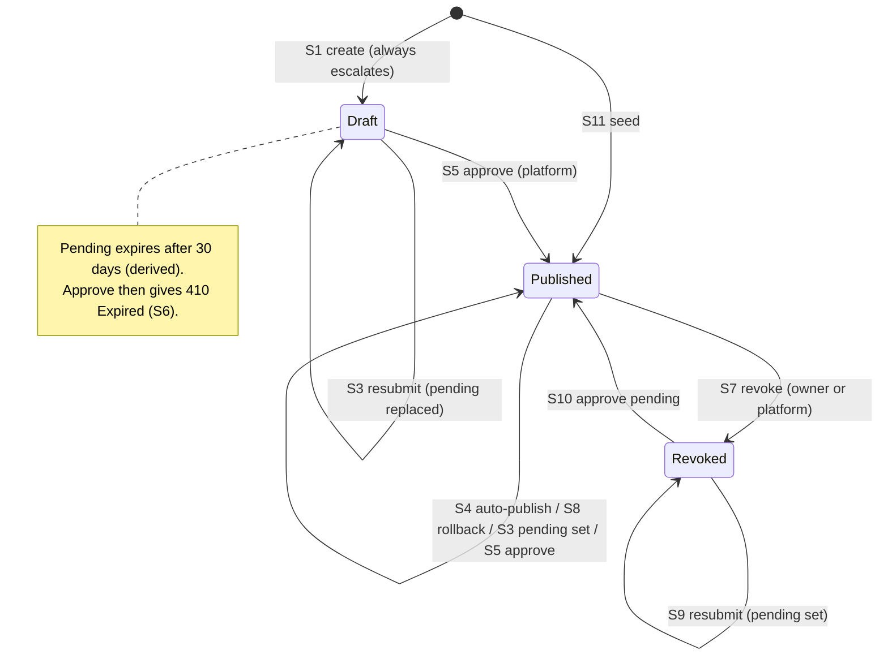
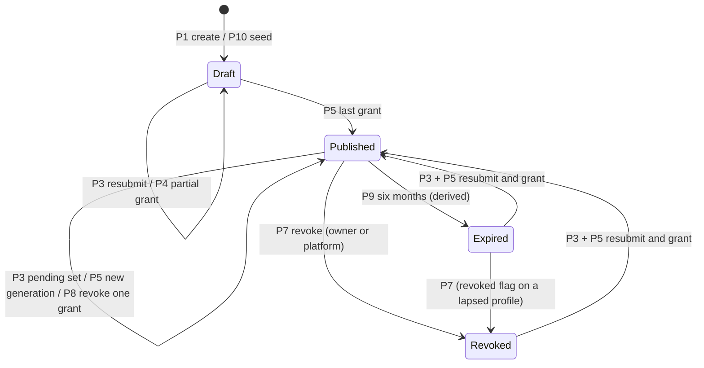
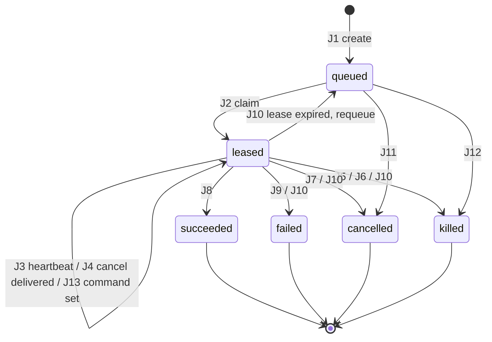

# fleet-control states and transitions

Inventory of every state and transition for `MCPServer`, `AgentProfile` and
`AgentJob`, read from the code on `main` (step 1 of #3074). It describes what
the code does today, not what it should do. The walkthrough (step 2) marks
each row as intended, bug or missing; the questions are at the end.

All paths are relative to `apps/fleet-control/internal/`. HTTP routes are
under `/apis/fleet.nav.no/v1alpha1/namespaces/{namespace}/`
(`api/apis.go:245-275`).

## Summary

| Kind | Stored states | Derived states | Transitions |
| --- | --- | --- | --- |
| MCPServer | 3: `draft`, `published`, `revoked` | pending (live or expired), blocked generation | 11 |
| AgentProfile | 3: draft (never published), published, revoked | pending (live or expired), expired approval, revoked grant | 10 |
| AgentJob | 6: `queued`, `leased`, `succeeded`, `failed`, `cancelled`, `killed` | command `continue`/`cancel`/`kill`, kill switch | 14 |

Common rules:

- **Actors.** *Owner team*: member of the resource's namespace (`memberOf`,
  `api/apis.go:308-313`; anyone else gets 404). *Platform team*: member of
  the configured operator team (`isPlatform`, `api/servers_http.go:41-43`;
  unset means nobody). *System*: seed import, the lease sweeper, a runtime.
- **Reason text.** Revoke and rollback need `reason`, 1 to 500 characters,
  else 400 `ReasonRequired` (`api/servers_http.go:191-196`).
- **Optimistic lock.** PUT needs a matching `resourceVersion`, else 409
  `StaleResourceVersion` (`api/servers_lifecycle.go:68`,
  `api/apis_agents.go:789`).
- **Pending expiry.** A pending generation is valid for 30 days from
  submission (`pendingValidity`, `api/agents.go:93`). Nothing writes the
  expiry: it is computed when approving (`api/servers_lifecycle.go:209`,
  `api/apis_agents.go:892`) and when comparing a resubmission
  (`api/servers_lifecycle.go:90`, `api/apis_agents.go:798`). An approval
  after expiry commits only an `approval_expired` audit row and answers 410
  `Expired` (`api/agents.go:96-97`).
- **Blocked content.** Any submission whose hash equals a blocked
  generation's hash is 422 `ContentBlocked`
  (`api/servers_lifecycle.go:30-39`).
- **No delete.** `DELETE` is 405 `MethodNotAllowed`: revoke instead
  (`api/apis.go:282`).

## MCPServer

### States

| State | Stored as | Meaning |
| --- | --- | --- |
| Draft | `servers.status = 'draft'`, `published_version IS NULL` | Never published. Usually has a pending generation. |
| Published | `status = 'published'`, `published_version` set | Serving the published generation. |
| Revoked | `status = 'revoked'`, `published_version` kept | Stopped. The route stays in the snapshot as disabled, so the gateway answers 503 (`api/snapshot.go:55-68`). |
| + Pending | `servers.pending_version` set | A generation waits for the platform team. Combines with every state above. |
| + Pending expired | derived: `created_at + 30 days <= now()` | Not stored. `PendingApproval` stays `True` (`api/servers_read.go:243`). |
| Blocked generation | `server_versions.blocked` | Content can never be published or rolled back to again. |

Shape constraints: `status IN ('draft','published','revoked')` and
`published_version IS NULL` if and only if `draft`
(`store/migrations/002_write.sql:5-6`). Per generation: `approved_via IN
('platform','auto','seed')` (`store/migrations/014_platform_approval.sql:13`),
`auto` has no approver (`014_platform_approval.sql:20-21`), and
`self_approved` matches the people on the row (`014_platform_approval.sql:17-19`).

Conditions on read (`api/servers_read.go:208-245`): `Published`
(`NeverApproved`/`Approved`/`RolledBack`/`Revoked`), `PendingApproval`
(`NothingPending`/`AwaitingPlatformTeam`), `Revoked`
(`NotRevoked`/`RevokedByOwner`/`RevokedByPlatform`/`Blocked`), `Ready`
(`Serving`/`PendingApproval`/`Revoked`).

### Transitions

| # | From | Event | To | Actor | Preconditions (in code order) | Audit | HTTP |
| --- | --- | --- | --- | --- | --- | --- | --- |
| S1 | none | `POST mcpservers` | Draft + pending | owner team | member of ns (`api/servers_http.go:107`); spec valid (`:114`); name free, else 409 `AlreadyExists` (`api/servers_lifecycle.go:59-61`); not blocked content (`:97`). `Classify(nil, …)` always escalates: "first version" (`model/escalation.go:40-43`) | `draft_submitted` (`api/servers_lifecycle.go:131`) | 201 |
| S2 | any | `PUT`, same spec as live pending or published, not revoked | unchanged | owner team | an expired pending does not count as same (`api/servers_lifecycle.go:89-93`) | `metadata_updated` (`:94`) | 200 |
| S3 | Draft, Published, Revoked | `PUT`, change escalates | same + pending (replaces older pending) | owner team | resourceVersion (`:68`); not blocked (`:97`); escalates when not published, published generation has `approved_via IS NULL`, or `Classify` finds one (`:142-156`, `model/escalation.go:36-109`) | `draft_submitted` with `escalations` (`:131`) | 200 |
| S4 | Published | `PUT`, change does not escalate | Published (new generation), pending cleared | owner team | as S3, then route lock, registry name free, else 409 `RegistryNameTaken`; routes budget, else 409 `OverSnapshotBudget`/`OverTeamBudget`/`InvalidSnapshot` (`api/servers_lifecycle.go:161-186`, `api/snapshot.go:156-172`) | `auto_published`, `approvedBy: auto` (`:184`) | 200 |
| S5 | any + pending | `POST …/approval` | Published, pending cleared | platform team | approverGuard: owner team outside platform gets 403 `NotPlatformTeam`, others 404 (`api/servers_http.go:169-177`); generation is the pending one, else 409 `GenerationNotPending` (`api/servers_lifecycle.go:198-200`); not expired (S6); hash matches, else 409 `ContentHashMismatch` (`:215-216`); submitter is a User with oid, else 403 `SubmitterNotPerson` (`:217-218`); approver has oid, else 403 `ApproverNoOid` (`:219-221`); platform team again (`:222-223`); registry name prefix allowed, else 422 `RegistryNameNotYours` (`:224-225`); not blocked (`:228`); route lock; registry name free (`:243-245`); routes budget (`:248`). Self-approval allowed, marked `self_approved` (`:236`) | `approved_published`, outcome `approved` or `self_approved` (`:251-255`) | 200 |
| S6 | any + pending expired | `POST …/approval` | unchanged | platform team | as S5 up to the expiry check | `approval_expired` (`:209-213`) | 410 `Expired` |
| S7 | Published | `POST …/revocation` | Revoked; generation `revoked_at`, and `blocked` if `block: true` | owner team or platform team | operatorOr: others 404 (`api/servers_http.go:181-189`); reason (`:211`); status is published, else 409 `NotPublished` (`api/servers_lifecycle.go:271-273`) | `revoked` with `by`, `blocked` (`:280`) | 200 |
| S8 | Published | `POST …/rollback` | Published (earlier generation) | owner team only | member of ns (`api/servers_http.go:226`); reason (`:239`); route lock first (`api/servers_lifecycle.go:293`); status published, else 409 `RollbackRevoked` (`:297-299`); `fromGeneration` is the published one, else 409 `FromGenerationMismatch` (`:300-302`); target earlier and once published, else 409 `RollbackTargetNotEligible` (`:309-315`); target `approved_via` not NULL, else 409 `RollbackTargetNotApproved` (`:321-327`); target not blocked/revoked/same content as either, else 409 `GenerationBlocked`/`GenerationRevoked`/`ContentRefused` (`:328-339`); registry name rules (`:340-347`); routes budget (`:349`). No `Classify` | `rolled_back` (`:352`) | 200 |
| S9 | Revoked | `PUT` (any change, even same content) | Revoked + pending | owner team | as S3; always escalates because status is not published (`:143-144`) | `draft_submitted` | 200 |
| S10 | Revoked + pending | `POST …/approval` | Published | platform team | as S5; approve does not check status, and revoke leaves `pending_version` in place (`:274`) | `approved_published` | 200 |
| S11 | none | seed import at start (empty table only) | Published, `approved_via = 'seed'` | system | `HasServers` false (`api/server.go:195-214`) | `seed_published` (`store/servers.go:43-66`) | n/a |

Revoke is final for that generation: rollback never returns to it
(`api/servers_lifecycle.go:263-264`, `:335-336`).

## AgentProfile

### States

Stored in `agent_profile_resources` and `agent_profile_generations`
(`store/migrations/005_v1alpha1.sql:45-100`). The old `agent_profiles.status`
column with `draft/approved/expired/revoked` was dropped
(`store/migrations/011_drop_legacy.sql:5-6`); state is now pointers and flags.

| State | Stored as | Meaning |
| --- | --- | --- |
| Draft | `published_generation IS NULL`, `pending_generation` set | Never published. |
| Partially granted | pending, some rows in `agent_profile_grants` | Waits for the remaining server owner teams. |
| Published | `published_generation` set, `revoked = false` | Live, if also verified and not expired. |
| Revoked | `revoked = true`, generation `revoked_at` | Stopped. A new submission restarts it. |
| Expired approval | derived: `expires_at <= now()`, 6 months from the oldest grant (`api/agents.go:89`, `api/apis_agents.go:962-967`) | Not stored. Condition `Expired`/`ApprovalExpired` (`api/apis_agents.go:688`, `:728-737`). |
| Revoked grant | `agent_profile_grants.revoked_at` | One server's grant removed; profile stays published. |
| + Pending expired | derived, 30 days (`api/apis_agents.go:509`) | `PendingApproval` stays `True` (`:735`). |
| Needs resubmit | pending submitted by a non-User | Seeded draft; nobody can grant it (`api/apis_agents.go:665`). |

Shape constraints: generations need a client id or identity subject, and
issuer and subject come in pairs
(`store/migrations/012_identity_issuer_subject.sql:13-17`).

Conditions (`api/apis_agents.go:690-740`): `Published`, `PendingApproval`
(`AwaitingGrant`), `Revoked`, `Expired` (`ApprovalExpired`),
`IdentityVerified` (`ClientIDMatchesApp`), `Ready`
(`Serving`/`ToolsMissing`/`NotVerified`/`Expired`/`Revoked`/`PendingApproval`).

### Transitions

| # | From | Event | To | Actor | Preconditions | Audit | HTTP |
| --- | --- | --- | --- | --- | --- | --- | --- |
| P1 | none | `POST agentprofiles` | Draft | profile's owner team | member of ns (`api/apis_agents.go:339`); spec valid (`:108-162`); every granted server published behind the gateway with the tools, else 422 (`:178-196`); identity verified when a verifier is set, else 422 (`:353-362`); name free, else 409 `AlreadyExists` (`:780-782`); not blocked (`:806`); client id not live elsewhere, else 409 `ClientIDInUse` (`:812-819`); issuer configured, else 503 `IssuerNotConfigured` (`:828-830`) | `agent_profile_submitted` (`:840`) | 201 |
| P2 | any | `PUT`, same spec as live pending or published, not revoked | unchanged | owner team | (`:796-804`) | `metadata_updated` (`:803`) | 200 |
| P3 | any (Draft, Published, Revoked, Expired) | `PUT`, new spec | same + pending (replaces older pending; its grants lapse) | owner team | as P1 plus resourceVersion (`:789`) | `agent_profile_submitted` | 200 |
| P4 | pending | `POST …/approval` with `serverRef`, not the last grant | Partially granted | owner team of the granted MCP server | grantTeamGuard: profile team gets 403 `NotServerOwnerTeam`, others 404 (`:381-391`); grantVisible 404 before any state is revealed (`:848-861`, `:872`); pending generation, else 409 `GenerationNotPending` (`:875-877`); grant in generation, else 409 `GrantNotInGeneration` (`:882-887`); not expired (P6); grant hash matches, else 409 `ContentHashMismatch` (`:899-900`); submitter is a User with oid, else 403 `SubmitterNotPerson` (`:901-902`); granter is not the submitter, else 403 `SelfApproval` (`:903-904`); server still published with the tools (`:907-912`); not granted twice, else 409 `AlreadyGranted` (`:918-920`) | `agent_profile_access_granted` (`:921`) | 200 |
| P5 | pending | grant, last one | Published, pending cleared, `revoked = false` | owner team of the server | as P4; all servers locked and rechecked (`:935-942`); no grant revoked and no server revoked since its grant, else 409 `GrantRevokedSinceApproval` (`:943-951`); client id free, else 409 `ClientIDInUse` (`:955-961`); sets `expires_at` (`:963-967`) | `agent_profile_access_granted` + `agent_profile_published` (`:968`) | 200 |
| P6 | pending expired | grant | unchanged; earlier grants lapse | owner team of the server | as P4 up to the expiry check | `approval_expired` (`:892-897`) | 410 `Expired` |
| P7 | Published | `POST …/revocation` without `serverRef` | Revoked, client id released | profile's owner team or platform team | operatorOr (`:426`); reason (`:431`); published and not revoked, else 409 `NotPublished` (`:989-991`) | `agent_profile_revoked` (`:1007-1013`) | 200 |
| P8 | Published | `POST …/revocation` with `serverRef` | Published, grant revoked | owner team of the server | grantTeamGuard (`:424`); grantVisible (`:985`); published (`:989`); active grant, else 409 `NoActiveGrant` (`:993-1000`) | `agent_profile_access_revoked` (`:1005`) | 200 |
| P9 | Published | time passes 6 months | Expired (derived) | system (no write) | client id released lazily on the next claim of the same id (`:744-754`); jobs refuse it (`api/apis_jobs.go:84-85`) | none | n/a |
| P10 | none | dev seed | Draft by `System`, needs resubmit | system | dev clusters only (`api/agents.go:167`) | `agent_profile_submitted` (`api/apis_agents.go:1035`) | n/a |

There is no rollback for profiles.

## AgentJob

### States

`runtime_jobs.state IN ('queued','leased','succeeded','failed','cancelled','killed')`
and `command IN ('continue','cancel','kill')`
(`store/migrations/004_runtime_jobs.sql:9-15`). Leases in `runtime_leases`.
Kill switches in `runtime_kill_switches`, scope `global` or `team:<name>`
(`004_runtime_jobs.sql:39-40`). Conditions: `Running`, `Complete`, `Failed`
(`api/apis_jobs.go:192-201`).

### Transitions

| # | From | Event | To | Actor | Preconditions | Audit | HTTP |
| --- | --- | --- | --- | --- | --- | --- | --- |
| J1 | none | `POST agentjobs` | queued | person in ns, or app of a published profile in ns | jobScope: unknown client 401 `UnknownClient`, other ns 404 (`api/apis_jobs.go:108-124`); live profile: not revoked, not blocked, approved, verified, not expired (`:81-85`, `:297-315`); delegated orderer needs issuer and subject, else 503 `OrdererUnknown` (`:327-329`); same name and spec returns existing, other spec 409 `AlreadyExists` (`:332-349`); kill switch off, else 503 `KillSwitchOn` (`:355-364`) | `job_created` (`:375`) | 201 (200 on idempotent retry) |
| J2 | queued | `POST /runtime/v1/claim` | leased | runtime (system) | team in runtime's teams, no kill switch, oldest first (`api/jobs.go:334-337`); same token returns the same lease (`:307-333`) | `job_claimed` (`:351`) | 200 |
| J3 | leased | heartbeat, command continue | leased (lease extended) | runtime | lease held and not expired, else 410 `LeaseEnded` or 404 (`:383-401`) | none (`:429-430`) | 200 |
| J4 | leased | heartbeat, command cancel | leased, lease capped at one TTL | runtime | as J3 | `cancel_delivered` on first delivery (`:431-444`) | 200 |
| J5 | leased | heartbeat, command kill or kill switch on | killed, lease ended | runtime | as J3 (`:412-428`) | `kill_delivered` (`:427`) | 200 |
| J6 | leased | `complete`/`fail`, kill pending or switch on | killed | runtime | as J3; kill wins over the reported result (`:463-471`) | `job_killed` (`:479`) | 200 |
| J7 | leased | `complete`/`fail`, cancel pending | cancelled | runtime | as J3 | `job_cancelled` | 200 |
| J8 | leased | `complete` | succeeded | runtime | as J3 | `job_succeeded` | 200 |
| J9 | leased | `fail` | failed | runtime | as J3 | `job_failed` | 200 |
| J10 | leased | lease expires (sweeper or claim) | killed / cancelled / queued (requeue, attempts left) / failed | system | `SKIP LOCKED` sweep (`:214-253`) | `lease_expired` with `after` (`:248`) | n/a |
| J11 | queued | `POST …/termination` Cancel | cancelled | orderer (same client and subject) | jobScope (`api/apis_jobs.go:393`); mode and reason ≤ 500, else 400 (`:400-403`); own job by name, else 404 (`:406-409`) | `job_cancel` (`api/jobs.go:168`) | 200 |
| J12 | queued | termination Kill | killed | orderer | as J11 | `job_kill` | 200 |
| J13 | leased | termination Cancel or Kill | leased, command set | orderer | as J11; kill already set, else 409 `AlreadyKilling` (`api/jobs.go:158-161`) | `job_cancel`/`job_kill` | 200 |
| J14 | terminal | termination | unchanged | orderer | 409 `JobNotActive` (`api/jobs.go:162-163`) | none | 409 |

Kill switch: `PUT /admin/v1/jobs/{namespace}/kill-switch`
(`api/handlers.go:36`), reason required (`api/jobs.go:662`); the global switch
and other teams' switches need the operator team, else 403
`NotOperatorTeam` (`:671`); a switch the operator team set only it clears
(`:199-201`). Audit `kill_switch` (`:208`). It changes no job state directly:
it blocks J1 and J2 and turns J3 into J5.

## Spørsmål til gjennomgangen

Questions for the walkthrough, most important first.

1. **Revoke leaves the pending generation approvable (S10).** `revokeServer`
   does not clear `pending_version` (`api/servers_lifecycle.go:274`), and
   `approveServer` does not check status (`:198`). A generation submitted
   before a revocation can bring the server back with one platform approval.
   Intended restart path, or should revoke drop the pending generation?
2. **Rollback runs no escalation check (S8).** Rollback only requires the
   target to have `approved_via` set (`:321-327`). It may return to a
   generation with more tools or a lower risk than the current one, which
   `Classify` treats as an escalation on submit (`model/escalation.go:87-95`).
   #3062 says a shrinking rollback always passes; is a widening one meant to
   pass too, because it was approved once?
3. **Two meanings of "expired".** Reason `Expired` (410) is a pending
   generation older than 30 days (`api/agents.go:96-97`). Condition
   `Expired`/`ApprovalExpired` is a published profile older than 6 months
   (`api/apis_agents.go:688`, `:728-737`). MCPServer has no expiry condition
   at all, and `PendingApproval` stays `True` after a pending generation
   expires on both kinds (`api/servers_read.go:243`,
   `api/apis_agents.go:735`). Rename one, and add `PendingExpired`?
4. **Profile grants keep the four-eyes rule that servers dropped.**
   `grantProfile` refuses the submitter with 403 `SelfApproval`
   (`api/apis_agents.go:903-904`); server approval allows it and marks
   `self_approved` (`api/servers_lifecycle.go:236`). Grants also skip the
   `ApproverNoOid` check that servers have (`:219-221`), so an empty oid
   reaches the `::uuid` cast at `api/apis_agents.go:914` (likely 500, not
   verified). Align?
5. **Jobs outlive their profile.** J1 checks the profile is live, but J2
   (`api/jobs.go:334-337`) and J3 do not. A job queued before a profile is
   revoked or expires still runs. Should revoke or expiry cancel queued jobs,
   or should claim check the profile?
6. **Profile expiry is never written.** Expiry is computed at read time; the
   client id is released only when someone claims the same id
   (`api/apis_agents.go:744-754`, a marked shortcut). Is a sweeper needed
   before prod, as the comment says?
7. **Policy in CHECK constraints.** `server_versions_auto_has_no_approver`
   (`store/migrations/014_platform_approval.sql:20-21`) encodes "auto has no
   approver"; `servers_published_status` (`002_write.sql:6`) ties `draft` to
   a NULL pointer, so "revoked before ever published" cannot exist. The
   four-eyes CHECKs (`002_write.sql:17`, `005_v1alpha1.sql:22-23`) needed a
   migration to drop (`014_platform_approval.sql:14-15`). Per #3074 step 3,
   which of these are shape and which are policy to move into `Decide`?
8. **Status representations overlap.** Servers keep `status` plus two
   pointers; profiles keep a `revoked` flag plus pointers plus per-generation
   `revoked_at`/`blocked`. Revoked-by-whom comes from `resource_status`
   (`api/servers_read.go:225-229`), which only the audit trigger writes
   (`store/migrations/009_identity_retention.sql:45-78`). One stored state
   per kind?
9. **Blocked only on revoke for servers.** Servers block at revocation
   (`block: true`, `api/servers_lifecycle.go:277`); profile generations have
   a `blocked` column (`005_v1alpha1.sql:78`) but no API sets it. Missing, or
   dead column?
10. **Kill switch leaves queued jobs queued.** A switch blocks claims
    (`api/jobs.go:336`) but does not cancel queued jobs; they run when it is
    turned off. Intended?
11. **Legacy approvals escalate forever.** A server whose published
    generation has `approved_via IS NULL` escalates every change
    (`api/servers_lifecycle.go:152-154`) and cannot be rolled back to.
    Is a one-off backfill wanted, or is this the migration path?
12. **Partial grants before expiry.** Grants given on a pending generation
    lapse silently when it expires (P6) or is replaced (P3); no audit row
    records the lapse. Add one?
