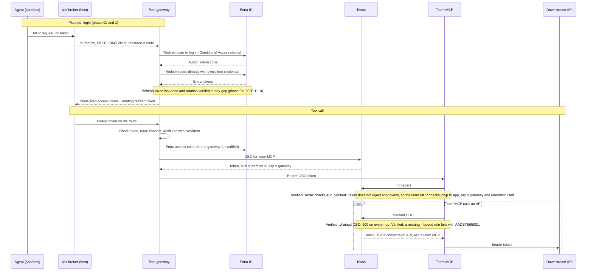
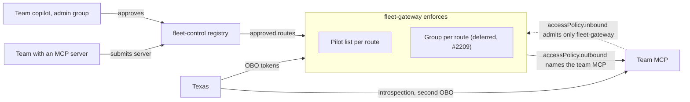

# MCP gateway: plan and path forward

Names follow the nav-fleet draft, which is not final: fleet-gateway is the MCP gateway, and the registry is part of fleet-control. App and host names such as mcp-registry stay unchanged for now.

Status 2026-11-16: the phase 0 spike passed in tenant nav.no; chained OBO works and the kill criterion was not triggered ([#2084 (comment)](https://github.com/navikt/copilot/issues/2084#issuecomment-6925521276)). Epic: [#2083](https://github.com/navikt/copilot/issues/2083). Registry self-service: [#2096](https://github.com/navikt/copilot/issues/2096). Client side: [navikt/cplt#912](https://github.com/navikt/cplt/issues/912), design in [navikt/cplt#947](https://github.com/navikt/cplt/pull/947) (merged 2026-11-04).

## Goal

Teams ship MCP servers without building their own OAuth. One gateway on Nais, fleet-gateway, handles login, issues per-server tokens and calls each team MCP with Texas on-behalf-of (OBO). Teams register their servers on ki-utvikling. cplt keeps the tokens on the host, out of the agent sandbox.

## Decided architecture

| Topic | Decision | Source |
|---|---|---|
| Ownership | We build, own and run fleet-gateway for good | [#2088](https://github.com/navikt/copilot/issues/2088) |
| Login | fleet-gateway is its own OAuth 2.1 authorization server in front of Entra; Entra-direct revisited before phase 3 if Nais can support it | [#2089](https://github.com/navikt/copilot/issues/2089) |
| Refresh tokens | Stored in fleet-gateway, encrypted, at most 10 hours; strategy revisited after phase 0b (decisions log 2026-11-16) | [#2090](https://github.com/navikt/copilot/issues/2090) |
| Writes | Read-only at first; writes later as a consent-page scope | [#2091](https://github.com/navikt/copilot/issues/2091) |
| Audit | One line per tool call, NAVident, 90 days | [#2092](https://github.com/navikt/copilot/issues/2092) |
| Registry approval | Gateway team MCPs: admin queue on ki-utvikling. External servers: PR review | [#2093](https://github.com/navikt/copilot/issues/2093), [#2096](https://github.com/navikt/copilot/issues/2096) |

Owner decisions 2026-11-02:

1. **Login guard for cplt**: a fixed loopback port, held by the host broker before the sandbox starts and listed in the CIMD `redirect_uris`. The short code is UX text only. The callback path has no random segment; `state` and PKCE stay.
2. **Registry writer**: folded into mcp-registry. One app, one database, one validator.
3. **Registry admins**: an Entra group through the `groups` claim from Texas introspection. No email list.
4. **First remote for cplt OAuth**: fleet-gateway, then Figma.
5. **Client registration**: CIMD only in the pilot. DCR (and OpenCode, which needs it) after the pilot, with a per-IP cap and expiry of unused clients.
6. **Registry PRs** [#2102](https://github.com/navikt/copilot/pull/2102) and [#2110](https://github.com/navikt/copilot/pull/2110): fix review findings now, merge after the chained-OBO spike passes. The spike passed 2026-11-16; both are unblocked.
7. **Privacy**: one compliance document covering refresh tokens and the audit log, written during phase 1.
8. **`offline_access`**: tested in phase 0b. If Entra refuses, #2090 is revisited before phase 1.

## Token flow

Unverified marks behaviour that no spike or Nais documentation has confirmed yet.

1. **Agent to cplt host broker.** No token. The broker keeps credentials out of the sandbox ([navikt/cplt#947](https://github.com/navikt/cplt/pull/947), section 14).
2. **cplt broker to gateway authorization server.** Authorization code with PKCE. The client is identified by a CIMD document (`oauth-client.json`) that my-copilot will publish (#2085); the callback goes to the fixed loopback port the broker holds. fleet-gateway issues a short-lived access token and a rotating refresh token, stored by cplt in a `0600` file in its state dir.
3. **Gateway to Entra ID.** fleet-gateway is the Entra confidential client that Nais provisions (`azure.application`). It sends the user to Entra to log in, passing any Conditional Access `claims` on `/authorize`. Texas has only `/token`, `/token/exchange` and `/introspect`, so fleet-gateway redeems the code and refreshes against Entra directly with its own client credential. It keeps the Entra refresh token encrypted and deletes it after at most 10 hours ([#2090](https://github.com/navikt/copilot/issues/2090)). Refresh-token issuance and rotation via `offline_access` are verified in dev-gcp, phase 0b on 2026-11-16 ([#2084](https://github.com/navikt/copilot/issues/2084)), while the prod repeat and the final strategy decision ([#2090](https://github.com/navikt/copilot/issues/2090)) remain pending.
4. **cplt broker to gateway route.** Bearer gateway access token. fleet-gateway checks the token, consent for that route, and writes one audit line with NAVident ([#2092](https://github.com/navikt/copilot/issues/2092)). Opaque: cplt cannot check `aud` and relies on fleet-gateway binding the token to the route (RFC 8707). JWT: cplt refuses to send a token whose `aud` is not the route.
5. **Gateway to team MCP.** fleet-gateway gets an Entra access token for itself from the stored refresh token by calling Entra directly (unverified), then Texas OBO exchanges it for one scoped to the team MCP. The team MCP validates it, checks that `azp` is fleet-gateway's client id, rejects `idtyp=app`, requires NAVident, and its `accessPolicy.inbound` admits only fleet-gateway. fleet-gateway is the single policy point: route consent, read-only mode and the tool allowlist are enforced there from the pilot.
6. **Team MCP to downstream API.** A second Texas OBO on the OBO token. Verified in the phase 0 spike: 200 on every hop, `aud` is the hop's own app, `azp` the previous hop, NAVident carried throughout.

Texas introspection checks `aud`: the spike sent fleet-gateway's token unchanged to the team MCP and got `InvalidAudience`. Texas is not documented to check `azp` or `groups` (unverified). It does not reject app tokens: a client-credentials token came back `active: true` with `idtyp: app`. Every team MCP must therefore check `idtyp`, check that `azp` is fleet-gateway's client id, and require NAVident itself.

A missing inbound rule fails the OBO in Entra with `invalid_grant` / `AADSTS65001` ("has not consented"), returned by Texas as a 400. fleet-gateway and team MCPs must translate it to "missing access to the next app (inbound rule)"; otherwise the user sees a consent error.

The diagram shows the same flow. "Verified" marks what the phase 0 spike proved; everything else is planned.

To test, get user tokens from the Nais login sidecar (Wonderwall) on the calling app, as the spike did. `azure-token-generator` does not support the nav.no tenant (Nais docs).

## Phases and gates

Each phase starts only when the previous gate holds.

| Phase | What | Gate to pass | Tracked in |
|---|---|---|---|
| 0 spike | Chained OBO through Texas, stub apps in dev-gcp | A team MCP exchanges fleet-gateway's OBO token for its own downstream token. Fails: the fleet-gateway approach is killed. **Passed 2026-11-16** | [#2084](https://github.com/navikt/copilot/issues/2084), [#2094](https://github.com/navikt/copilot/pull/2094) |
| 0b | Minimal authorization server on the dev stub, CIMD only; also group-restricted apps (`allowAllUsers: false`), a Conditional Access challenge and the prod tenant, which the spike did not test | One `tools/call` from Copilot CLI via CIMD reaches the pilot as the real user; an audit line names NAVident and the tool; `offline_access` result recorded | [#2084](https://github.com/navikt/copilot/issues/2084) |
| 1 | cplt host OAuth against fleet-gateway, fixed-port guard, per-route consent, revocation; privacy document | `cplt mcp status` shows `credential_ok`; no token readable in the sandbox; privacy document signed off | [#2085](https://github.com/navikt/copilot/issues/2085), design merged in [navikt/cplt#947](https://github.com/navikt/cplt/pull/947) |
| 2 pilot | Prod route to nav-etterlevelse-mcp, reads only, next to its own OAuth server | 5 users, 2 weeks, zero auth incidents, latency target met, one survey answer per user | [#2086](https://github.com/navikt/copilot/issues/2086) |
| 3 | Template repo, direct clients, second team | A second team ships from the template in under a day | [#2087](https://github.com/navikt/copilot/issues/2087) |

### Registry phases mapped to gateway phases

| Registry phase | Content | Lands with |
|---|---|---|
| 1 | Database in mcp-registry, writer folded in, static file wins on name collision | After gateway phase 0 passes ([#2098](https://github.com/navikt/copilot/issues/2098)) |
| 2 | Submit form and `/admin` approval queue | Gateway phase 2 pilot ([#2099](https://github.com/navikt/copilot/issues/2099)) |
| 3 | Form open to all teams, edit, deprecate and rollback; fleet-gateway enforces `toolHashes` | Gateway phase 3 ([#2100](https://github.com/navikt/copilot/issues/2100)) |

The `owner`, `gateway` and `toolHashes` fields are already in the registry response format ([#2101](https://github.com/navikt/copilot/pull/2101)).

## External dependencies

| Dependency | Needed for | Status | Owner |
|---|---|---|---|
| Public ingress for fleet-gateway | Clients outside naisdevice, after the phase 2 pilot | Team does it; pilot stays on naisdevice ingress by decision. Nais apps declare `spec.ingresses` on `*.nav.no` in `prod-gcp` or `*.ekstern.dev.nav.no` in `dev-gcp` with no ticket, per the doc.nais.io `expose` how-to and naiserator ingress classes. | Team copilot |
| `offline_access` on a Nais Entra app | Refresh tokens, phase 0b | Resolved 2026-11-16 in phase 0b, [#2084](https://github.com/navikt/copilot/issues/2084). Entra issued and rotated a refresh token for a Nais `azure.application` in tenant `nav.no`, and the gateway redeemed it directly for the team MCP scope, strategy A. | — |
| `claims` in Texas error responses | Conditional Access challenges without a re-login loop | Team can contribute to `nais/texas`; not needed for the pilot. `nais/texas` is MIT-licensed and accepts PRs, and Entra's OBO error body carries `claims`, so a PR can pass `claims` through. Gateway code and refresh calls hit Entra's /token endpoint directly and receive claims errors; /authorize already passes claims. | Team copilot, optional post-pilot PR |
| Privacy sign-off | Refresh tokens and audit with NAVident, before phase 2 | Partly self-service. The team drafts the Behandlingskatalog processing record, Etterlevelse answers, risk assessment and PVK/DPIA in `etterlevelse.ansatt.nav.no`. The data protection officer (personvernombud) advises on the PVK/DPIA, and the accountable owner on the controller side approves it and accepts residual risk. Exception: owner_navident stays while the entry exists; registry version rows clear submitted_by after 90 days. | Team copilot drafts; data protection officer advises; accountable owner approves |
| Pilot team agreement | Phase 2 | Not asked yet. Teams apply via the [fleet-gateway: Pilotsøknad](https://github.com/navikt/copilot/issues/new?template=fleet-gateway-pilot.yml) issue form; the pilot team must agree and add fleet-gateway to `accessPolicy.inbound`. | Team copilot and pilot team |

## Open risks

- Resolved 2026-11-16, [#2084](https://github.com/navikt/copilot/issues/2084): Entra issued and rotated a refresh token via `offline_access` for a Nais `azure.application` in tenant `nav.no`, and the gateway redeemed it directly for the team MCP scope, strategy A.
- Entra refresh tokens for non-SPA clients last 90 days, rotate without revoking the old one, and are not bound to a resource. "At most 10 hours" is only fleet-gateway's delete discipline. A database backup plus the encryption key plus the client secret lets an attacker impersonate every logged-in user on every route, unless consent is per route.
- Conditional Access `claims` from a downstream OBO hop cannot travel back through Texas yet. Accepted limit for the pilot: `nais/texas` is MIT-licensed and accepts PRs, Entra's OBO error body carries `claims`, and the team can contribute a passthrough PR later. Gateway code and refresh calls hit Entra's /token endpoint directly and receive claims errors; /authorize already passes claims.
- The dev tenant is not prod: a pass in dev-gcp does not prove prod-gcp.
- The consent page must: ask for consent before the gateway redirects back to the client (since 2026-11-17 it is shown after the Entra login, so a remembered consent can skip it), protect against CSRF, set `frame-ancestors`, match redirect URIs exactly, return `iss` in responses, and bind the token to the exact route resource.
- cplt's port guard has a gap: the sandbox can bind the loopback OAuth port after another holder releases it ([navikt/cplt#1017](https://github.com/navikt/cplt/issues/1017)).
- The writer has never been tested against real Texas introspection.
- OpenCode under cplt waits for DCR, which is out of the pilot.

## Onboarding and pilot control

Three layers must all hold before a route opens to wider use:

1. **Registry approval.** A submission stays pending until the admin group (team copilot) approves it ([#2110](https://github.com/navikt/copilot/pull/2110)).
2. **Nais access policy.** fleet-gateway's `accessPolicy.outbound` names every team MCP, and the team adds fleet-gateway to its `inbound`. A missing rule fails with `AADSTS65001`.
3. **Pilot list.** An explicit, versioned list of routes and teams in the fleet-gateway config. fleet-gateway exposes a route only if it is on the list and approved in the registry. Removing a route from the list switches it off.

The pilot accepts only cplt's client_id, on a naisdevice ingress. Teams apply through the issue template [fleet-gateway: Pilotsøknad](https://github.com/navikt/copilot/issues/new?template=fleet-gateway-pilot.yml) in navikt/copilot until the self-service form ([#2099](https://github.com/navikt/copilot/issues/2099)) exists. Preliminary user docs: [ki-utvikling.nav.no/verktoy/fleet-gateway](https://ki-utvikling.nav.no/verktoy/fleet-gateway) (added in a separate PR).

**Team guide.** A team connects its MCP server in four steps: add fleet-gateway (`copilot` namespace, `dev-gcp`) to `accessPolicy.inbound`; validate the token with Texas introspection and check `idtyp`, NAVident and `azp` itself; apply so team copilot adds the route to `pilot-routes.dev.yaml` and the server to `accessPolicy.outbound`; test against `https://fleet-gateway.intern.dev.nav.no/mcp/<route>` from cplt. Details and a token-check example: [ki-utvikling.nav.no/verktoy/fleet-gateway/for-team](https://ki-utvikling.nav.no/verktoy/fleet-gateway/for-team).

**Deferred: team-scoped access ([#2209](https://github.com/navikt/copilot/issues/2209)).** Owner decision 2026-11-17: teams authorize in their own MCP, and the pilot list has no `required_group`. If it returns, fleet-gateway checks the user's Entra group per route before the OBO call. nav-pilot may then show only the servers that match the user's teams, but that is convenience: a client can be changed, so the check in fleet-gateway is the control.

Texas issues the tokens. fleet-control grants access, and fleet-gateway enforces it.

## Setup checklist

In order. Who may join the pilot: see [Onboarding and pilot control](#onboarding-and-pilot-control). "Owner" means a human with the access; "agent" means repo work an agent can do.

| # | What | Where | Who | Tracked in |
|---|---|---|---|---|
| 1 | Done 2026-11-16: chained-OBO spike run, result on #2084, stub apps deleted, #2094 closed unmerged. Tested: chain, missing inbound rule, passthrough, app token. Group-restricted apps moved to phase 0b. | dev-gcp | Agent; owner | [#2084](https://github.com/navikt/copilot/issues/2084) |
| 2 | Phase 0b verified `offline_access` (T2) on 2026-11-16: Entra issued and rotated a refresh token for a Nais `azure.application` in tenant `nav.no`, and the gateway redeemed it directly for the team MCP scope, strategy A; T3/T4 remain. | Gateway app, Entra | Agent; owner | [#2084](https://github.com/navikt/copilot/issues/2084) |
| 2b | Repeat phase 0b in prod-gcp with a stub that holds no data, before phase 1 | prod-gcp | Agent builds the stub; owner runs | [#2084](https://github.com/navikt/copilot/issues/2084) |
| 3 | Public ingress after the pilot, which stays on naisdevice ingress by decision: declare `spec.ingresses` on `*.nav.no` in `prod-gcp` or `*.ekstern.dev.nav.no` in `dev-gcp`, no Nais ticket needed | fleet-gateway `.nais/*.yaml` | Team copilot | [#2083](https://github.com/navikt/copilot/issues/2083) |
| 4 | Optional after the pilot: contribute a PR to `nais/texas` passing `claims` from Entra's OBO error body through. Gateway code and refresh calls hit Entra's /token endpoint directly and receive claims errors; /authorize already passes claims. | `nais/texas` | Team copilot | [#2083](https://github.com/navikt/copilot/issues/2083) |
| 5 | Choose the loopback port and publish `oauth-client.json` with that `redirect_uris` entry | my-copilot, path set in #2085 | Owner picks port; agent publishes | [#2085](https://github.com/navikt/copilot/issues/2085) |
| 6 | Registry phase 1: replace the all-zero `admin_group_id` with the real Entra group | mcp-registry vars in [#2110](https://github.com/navikt/copilot/pull/2110) | Owner supplies ID; agent wires | [#2098](https://github.com/navikt/copilot/issues/2098) |
| 6b | Gateway phase 1: provision the refresh-token encryption key | Gateway secret | Owner supplies secret; agent wires | [#2090](https://github.com/navikt/copilot/issues/2090) |
| 7 | Pilot team agreement and `accessPolicy`: pilot team agrees via [fleet-gateway: Pilotsøknad](https://github.com/navikt/copilot/issues/new?template=fleet-gateway-pilot.yml) and adds fleet-gateway to `accessPolicy.inbound`; gateway adds team MCPs to `accessPolicy.outbound` | Gateway and team MCP `.nais/*.yaml` | Agent for gateway; pilot team owner for team MCP | [#2083](https://github.com/navikt/copilot/issues/2083) |
| 8 | Privacy sign-off: draft Behandlingskatalog processing record, Etterlevelse answers, risk assessment and PVK/DPIA in `etterlevelse.ansatt.nav.no` (Exception: owner_navident stays while the entry exists; registry version rows clear submitted_by after 90 days); get data protection officer advice and accountable owner approval | `etterlevelse.ansatt.nav.no`, `copilot-intern` | Team copilot drafts; data protection officer advises; accountable owner approves and accepts residual risk | [#2085](https://github.com/navikt/copilot/issues/2085) |

## Open decisions

1. Which loopback port cplt uses (checklist item 5).
2. Gateway access token format: opaque or JWT. Opaque: cplt cannot check `aud` and relies on fleet-gateway binding the token to the route (RFC 8707). JWT: cplt refuses to send a token whose `aud` is not the route.
3. Where the refresh-token encryption key lives: Nais secret or KMS.

## Decisions log

### 2026-11-17: consent, client paths, DCR and authorization

Owner decisions after the design review of 2026-11-17:

1. **Consent is remembered for 30 days** per user (NAVident), client_id and route (`CONSENT_TTL`, default `720h`). The gateway checks it after the Entra login and skips the consent page when a valid record exists. A new client or a new route still asks. Clients registered through DCR follow the same rules, but their first consent page shows an "unverified client" banner. `/revoke` clears the consent for that client and route ([#2223](https://github.com/navikt/copilot/issues/2223)).
2. **Both cplt paths are built:** native OAuth in the client and the cplt broker.
3. **DCR is on in prod while the ingress is naisdevice-only.** Before prod it needs TTL renewal on use and a cap sized from users × routes × clients ([#2261](https://github.com/navikt/copilot/issues/2261)).
4. **Teams authorize, the gateway authenticates.** The gateway logs in the user, binds the token to the route and writes the tool name to the audit log. Each team MCP decides what the user may do. `required_group` is removed for the pilot, and group restriction per route ([#2209](https://github.com/navikt/copilot/issues/2209)) is deferred.
5. **Accepted risk: silent login by a local process.** Consent is remembered for 30 days and loopback redirect URIs accept any port. Another process on the developer's machine can therefore start a login as an allowlisted public client and get a token without a click, through browser SSO and the remembered consent. PKCE does not help, because the attacker starts the flow. This is the same threat model as public-client logins in the az and gh CLIs. Mitigations: tokens are scoped to fleet-gateway, sessions are capped at 12 hours, and tokens can be revoked.

### 2026-11-17: direct MCP clients are a primary path

Owner decisions ([#2249](https://github.com/navikt/copilot/issues/2249), [#2250](https://github.com/navikt/copilot/issues/2250)):

1. **Direct clients are first-class.** Copilot CLI and OpenCode must work against fleet-gateway directly, without cplt. The cplt broker is an optional extra, not a requirement.
2. **Follow the MCP authorization spec as written**, with no client-specific code: PRM (RFC 9728), AS metadata (RFC 8414), CIMD, DCR (RFC 7591), PKCE S256 and RFC 8707 `resource`. Any spec-compliant MCP client should work. Which clients get in is configuration (the CIMD allowlist, the DCR flag), never a code path.
3. **Loopback redirects match on any port** for `http://127.0.0.1` and `http://[::1]` (RFC 8252 §7.3). Scheme, host, path and query must still match. `localhost` names never get this.
4. **DCR (#2270) is on in dev** (prod: see the consent decision above). Registered clients accept only loopback redirect URIs and `token_endpoint_auth_method: none`, live 30 days, and are capped globally and rate-limited per IP. The consent screen marks them as unverified.

Client support, verified against client source on 2026-11-17:

| Client | Path | Registration | Status |
|---|---|---|---|
| Copilot CLI (direct) | Primary | CIMD, `https://github.com/copilot/cli/client-metadata.json`, redirect `http://127.0.0.1:<random port>/` or `/callback` | Allowlisted in dev |
| OpenCode 1.19.x (direct) | Primary | DCR, one redirect `http://127.0.0.1:19876/mcp/oauth/callback`, auth method `none` | DCR in dev once #2270 lands |
| OpenCode, next release (direct) | Primary | CIMD `https://opencode.ai/oauth/opencode/client.json` when the server advertises CIMD, otherwise DCR with both a `127.0.0.1` and a `localhost` redirect | Allowlisted in dev; DCR drops the `localhost` entry |
| cplt broker (nav-pilot) | Optional | CIMD, `https://ki-utvikling.nav.no/cplt/oauth-client.json` | Allowlisted in dev |
| VS Code, Claude Code, MCP Inspector and other spec-compliant clients | Supported if they use CIMD from the allowlist or DCR with a loopback redirect | CIMD or DCR | Not tested |

### 2026-11-16: controlled onboarding

Owner decisions:

1. **Three layers before wider opening:** registry approval by team copilot, Nais `accessPolicy` on both sides, and a versioned pilot list in the fleet-gateway config that doubles as a per-route kill switch. Details: [Onboarding and pilot control](#onboarding-and-pilot-control).
2. **Pilot clients.** Only cplt's client_id, on a naisdevice ingress.
3. **Applications** go through the issue template [fleet-gateway: Pilotsøknad](https://github.com/navikt/copilot/issues/new?template=fleet-gateway-pilot.yml) until the self-service form ([#2099](https://github.com/navikt/copilot/issues/2099)).

### 2026-11-16: registry writes, personal data, database outage, spike gate

Owner decisions, recorded in [#2098 (comment)](https://github.com/navikt/copilot/issues/2098#issuecomment-6924375982) and implemented in [#2110](https://github.com/navikt/copilot/pull/2110):

1. **Write access.** The registry write endpoints accept only tokens whose `azp` is my-copilot, and an empty allowlist closes writes entirely. The free-text reason an admin gives when rejecting an entry is not logged. A 401 is logged without its cause; a 403 logs the rejected `azp`, or the NAVident of a non-admin. Mechanism (`ALLOWED_WRITE_AZP`, Nais pre-authorization): see the [mcp-registry README](../apps/mcp-registry/README.md).
2. **Personal data.** Audit and version rows store the caller's NAVident, not the email address. Audit rows (`registry_audit`) are deleted after 90 days. Version rows (`registry_entry_versions`) are kept for version history, but `submitted_by` is cleared after 90 days. `registry_entries.owner_navident` is kept while the entry exists, a deliberate exception to the 90-day rule, because ownership decides who may update the entry. The privacy document ([#2092](https://github.com/navikt/copilot/issues/2092)) must cover this exception. Logs carry no email address.
3. **Database outage.** Reads keep serving `allowlist.json`, writes answer 503, and the app retries connect and migrate in the background. The app does not exit fail-closed.
4. **Spike gate stands.** [#2102](https://github.com/navikt/copilot/pull/2102) and [#2110](https://github.com/navikt/copilot/pull/2110) merge together after the chained-OBO spike ([#2084](https://github.com/navikt/copilot/issues/2084)) passes.

Registry architecture: [`apps/mcp-registry/README.md`](../apps/mcp-registry/README.md#architecture).

### 2026-11-16: gateway auth review

A design review of the auth flow checked the plan against primary docs; findings are in Token flow and Open risks. Owner decisions:

1. **Spike scope.** Spike [#2094](https://github.com/navikt/copilot/pull/2094) gains passthrough, app-token and group-restricted tests before the owner runs it.
2. **Refresh-token strategy** is decided after phase 0b. Phase 0b tests two options: a refresh token per audience (no second OBO), and no refresh token (about a 1-hour session with silent re-login). Entra as the authorization server stays as the fallback.
3. **Pilot scope.** fleet-gateway accepts only cplt's client_id and starts on an internal (naisdevice) ingress. Public ingress comes later.

Sources: [Entra OBO](https://learn.microsoft.com/en-us/entra/identity-platform/v2-oauth2-on-behalf-of-flow), [Entra refresh tokens](https://learn.microsoft.com/en-us/entra/identity-platform/refresh-tokens), [Nais auth reference](https://doc.nais.io/auth/reference/), [Texas OpenAPI](https://github.com/nais/texas/blob/master/doc/openapi-spec.json), [MCP authorization](https://modelcontextprotocol.io/specification/draft/basic/authorization), [MCP security best practices](https://modelcontextprotocol.io/specification/draft/basic/security_best_practices).
